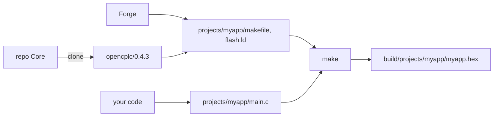

# OpenCPLC ⚒️ Forge

**Forge** is a console app that makes working with **OpenCPLC** easier.
Its job is to set up your environment so you can focus on building apps instead of fighting with configs and compilation.
Available as a **Python [`pip`](https://pypi.org/project/opencplc)** package or standalone **`opencplc.exe`** from 🚀[Releases](https://github.com/OpenCPLC/Forge/releases) _(in that case add its location to system `PATH` manually)_.

```sh
pip install opencplc
```

Pick a folder _(your workspace)_, open [CMD](#-console) and type:

```sh
opencplc -n <project_name> -b <board>
opencplc -n myapp -b uno
```

This creates `projects/<project_name>` _(nested folders when the name holds `/`)_.
Inside it Forge creates `main.c` and `main.h`, all a project needs.
Don't delete them or move them to subfolders.

When you have more projects, you can switch between them freely:

```sh
opencplc <project_name>
opencplc myapp
```

You can also pick projects by number from the list:

```sh
opencplc -l  # show project list
opencplc 3   # load project #3 from list
```

Every project owns its `makefile` and `flash.ld`, and `makefile` in the workspace root points at the active one.
Loading a project regenerates these files, which turn all sources _(project and framework `.c`, `.h`, `.s`)_ into `.bin` and `.hex` files ready to flash.

Changing `PRO_x` values in **`main.h`** or **project structure** _(adding, moving, deleting or renaming files)_ needs a reload.
`make` does it by itself: when `main.h` or any source is newer than `makefile`, it runs Forge first and then builds.
Editing function bodies needs no reload, `make` handles that on its own.
You can also reload by hand, without the project name when it's active or when you're inside its folder:

```sh
opencplc <project_name>
opencplc -r
```

`-o`, `-m`, `--plc`, `--drv` and `--boot` write their settings into `main.h`, for a new project and an existing one alike.
A flag forgotten at creation comes in with any later load, and `main.h` can always be edited by hand.

`-b` and `-c` work otherwise: they build an existing project for other hardware, with its memory and clock, while `main.h` stays as it is:

```sh
opencplc test/flash -c STM32WB55
```

`make` keeps that choice until you load the project without them.
A flag that writes `main.h` cannot be combined with them, or with `-f` of another Core, so `main.h` takes only what was checked against it.
Tests and demos for any board leave `PRO_BOARD`, `PRO_CHIP` and memory out of `main.h`, so every load names the hardware.

### 📂 Local project

A project can live outside the workspace, in a repository of its own.
A path names it, `./app` or `D:/repos/app`, while a plain name stays a project of the workspace:

```sh
cd C:/workspace
opencplc D:/repos/app
cd D:/repos/app
make
```

The first load runs in the workspace, since nothing ties the project to it before then.
From then on its `makefile` names the workspace, so `make` and `opencplc -r` work in its folder.
It builds with the framework of the workspace into its own folder under `build/local/` and never becomes the active project.
Forge writes `makefile`, `flash.ld` and `.vscode/` into its folder, overwriting them as it does in the workspace.
They hold paths of this computer, so the repository of the project should ignore them.
`opencplc -n D:/repos/app` creates a new local project.

### 📄 Your files

`main.c` is yours and Forge never overwrites it.
A PLC board project starts from this skeleton:

```c
#include <opencplc.h>

static void loop(void)
{
  while(1) {
    RGB_Set(&RGB, RGB_Green);
    delay(1000);
    RGB_Rst(&RGB);
    delay(1000);
  }
}

stack(stack_plc, 256);
stack(stack_dbg, 320);
stack(stack_loop, 1024);

int main(void)
{
  thread(PLC_Main, stack_plc); // PLC thread
  thread(DBG_Loop, stack_dbg); // logs and console
  thread(loop, stack_loop); // your application
  vrts_init(); // start thread switching
  while(1);
}
```

Your application runs as a VRTS thread next to PLC and debugger threads _(logs and console)_.
Add your own modules as more files in the project folder and its subfolders.

`main.h` holds configuration Forge reads on every load.
`PRO_*` definitions describe board, chip, PLC layer, framework version and memory sizes, while `LOG_LEVEL` and `SYS_CLOCK_FREQ` are yours to change.
Extra framework drivers go there too: `#define PRO_DRIVERS "shtc3, hd44780"`.

Here _(roughly)_ ends **Forge**'s job, and further work goes like any **embedded** project, with [**✨Make**](#-make).

## ✨ Make

With `makefile` generated by ⚒️**Forge**, open a console in your workspace to build the program and flash the PLC:

```sh
make build  # build C project to binary
make flash  # upload binary to PLC memory
# or
make run    # run = build + flash
```

`make` in workspace root works on the active project.
Any project can be built directly, independently of the active one: `make -C projects/myapp`.
Full list of targets:

- **`make build`** or just **`make`**: Builds C project to `.bin`, `.hex`, `.elf` files
- **`make flash`**: Uploads program to PLC _(microcontroller)_ memory
- **`make run`**: Does `make build`, then `make flash`
- `make test`: Builds every `.tests/*.c` into a program for this computer and runs it, see [Tests](#-tests); `make test T=name` runs one
- `make lint`: Checks the build with Forge rules, cppcheck and gcc analyzer, see [Lint](#-lint)
- **`make clean`** or `make clr`: Removes built files of the project
- `make clean_all` or `make clr_all`: Removes built files of all projects
- `make dist`: Packs the release into the project folder: `.hex` for programmers and, under the bootloader, `.bin` for updates; `make dist TAG=1.2.0` names them `<name>-1.2.0.hex` and `.bin`, and `CIPHER=` encrypts the `.bin` with a cipher key; built from nothing in a tree of its own, dated by the commit, with a `.json` record beside
- `make verify`: Builds as `make dist` does and compares the image with the record of `TAG=`, or of `RECORD=`
- `make update`: Sends the update image of the build over the console _(under the bootloader, with `CMD_BOOT ON`)_; `FILE=` sends another image, `PORT=` picks the port
- **`make erase`**: Completely wipes microcontroller memory _(**erase** full chip; on STM32WB the radio stack stays)_
- `make stack`: Flashes radio stack of the second core _(STM32WB)_; `make stack FUS=1` also provisions a factory-fresh board, once and irreversibly

Built files land in `build/projects/<project_name>/`: `.elf`, `.hex`, `.bin` and `.map` next to `opencplc/` with framework objects and `project/` with yours.
Programmers flash `-dist.hex`, and under the bootloader `-dist.bin` beside it carries updates.
Every project compiles the framework on its own, so switching projects never links objects built with another configuration.
After linking Forge reports memory use, and `make lint` the stack of each thread:

```text
FLASH 70.7kB / 72kB (98%)
RAM 34.3kB / 36kB (95%)
```

## 🥾 Bootloader

A project whose `main.h` includes `boot.h` runs behind Core's bootloader, which Forge builds with it, and takes updates without a programmer; `--boot` sets this up, at creation or later.
`opencplc --sign acme 3` adds sign keys to `BOOT_KEYS` in `boot.h`, and from then on the bootloader starts only images signed with them.
`opencplc --cipher acme-enc` makes a cipher key, and `make dist CIPHER=acme-enc` encrypts the update file with it, so nobody reads it on its way to devices.
`--lock` closes the board to programmers for production, with or without bootloader.
Both and their security: [🥾 Bootloader and 🔒 lock](https://github.com/OpenCPLC/Forge/wiki/bootlock).

## ⚙️ Config

With the first project ⚒️Forge creates config file **`opencplc.json`**.
It contains:

- **`version`**: Default OpenCPLC framework version for new projects. Value `latest` means newest stable version.
- `stlink`: Programmer bound to a project, so `make flash` hits the right board when several ST-Links are connected. Set it on the active project with `opencplc -s <serial>`, clear it with `opencplc -s`. Read the serial from OpenOCD log of `make flash` with one programmer connected.
- `ignore`: Projects left off `-l` and its numbers, as `.gitignore` patterns, e.g. `["demo/"]` hides all demos. Projects named directly still load. Add this key by hand when needed.
- `available-versions`: List of all available framework versions. Set automatically, used offline.

Workspace layout is fixed: `projects/` with your projects, `opencplc/` with framework versions and `build/` with built files.
Copy project folders by hand, and Forge finds them on its next run.

## 🤔 How works?

Who does what: Forge prepares the environment, Make builds and flashes, you write code.



On Windows ⚒️**Forge** brings its own **Make**, **GNU Arm Embedded Toolchain**, **OpenOCD** and **MinGW** into `%LOCALAPPDATA%\OpenCPLC`, no admin rights needed, and **Git** through `winget`.
After the first run open a new console, so `make` is on `PATH`.
On Linux tools come from your distribution.

Then, when needed, it clones OpenCPLC framework from its [repository](https://github.com/OpenCPLC/Core) into `opencplc/<version>`.
New projects take their version from `opencplc.json`, or from `-f --framework`:

```sh
opencplc <project_name> --new -f 0.4.3
opencplc <project_name> --new -f develop
```

Alone the flag only downloads, so you can read a version before any project points at it:

```sh
opencplc -f develop
```

### 📌 Project versioning

Each project keeps in `main.h` the framework version it was created with _(`PRO_FRAMEWORK`)_.
That version builds it and gets cloned when missing, so old projects compile even after framework updates.
If cloning fails, Forge warns and builds with the workspace default.

To try another version without touching `main.h`, pass `-f` when loading: the project builds with that version until a load without `-f`, and Forge says so.

Projects inside a framework version, such as its compile tests, load by path: `opencplc opencplc/develop/.tests/g081`.
They have no `PRO_FRAMEWORK` and build with the framework they lie in, into `build/opencplc/develop/.tests/g081/`.
`opencplc opencplc/develop` loads the framework itself, and `make test` runs its tests.

### 🧩 Boards

Boards come from the framework: each `brd/<board>/` folder with an `.ini` manifest is one.
Its manifest gives new projects their defaults: whether the board needs the PLC layer, chip, initial memory and clock, and drivers:

```ini
name = Uno
chip = STM32G0C1
plc = true
flash_kB = 492
ram_kB = 144
clock_Hz = 59904000
reserve_kB = 20
drivers = max31865
```

`reserve_kB` is optional: flash the board keeps for itself, taken off the top like the third value of `-m`, so projects start with what is left.

`name` is how the board reads in `main.h` and messages, `PRO_BOARD_Uno`, while its folder name stays in paths.
The two compare without case or underscores, so `CardG0` and `card_g0` are one board, and `None` means no board.

Adding boards means adding folders to the framework, with no change in Forge.
These are defaults, not rules: `-c` swaps chips _(memory follows the chip, clock stays with the board)_, and `--plc` adds the PLC layer to boards without it.
Only `plc = true` binds: such boards do not build without their layer.

Without a board `main.h` holds `PRO_BOARD_None`, and `PRO_PLC` decides the rest:
`-c <chip>` alone is bare metal _(HAL and libraries only)_, `-c <chip> --plc` adds the PLC layer on your own hardware, where peripheral mapping and `PLC_Main` are yours to write.

Device drivers live in `drv/`, outside the PLC layer, so any project can use them.
Folders under `drv/` group them by kind: `temp/` for thermometers, `acc/` for accelerometers, `disp/` for displays.
A driver goes by its file name, wherever it sits.
Boards take the ones their manifests name, and projects add more with `--drv` or in `main.h`: `#define PRO_DRIVERS "shtc3, hd44780"`.
Only named drivers reach the build.

Above all, **Forge** writes these files:

- `projects/<name>/flash.ld`: defines RAM and FLASH memory layout _(overwrites, STM32 only)_
- `projects/<name>/makefile`: contains build, clean and flash rules _(overwrites)_
- `makefile`: points at the active project _(overwrites)_
- `c_cpp_properties.json`: sets header paths and IntelliSense config in VS Code _(overwrites)_
- `launch.json`: configures debugging in VSCode _(overwrites)_
- `tasks.json`: describes tasks like compile or flash _(overwrites)_
- `settings.json`: sets local editor preferences _(creates once, not overwritten)_
- `extensions.json`: suggests useful VSCode extensions _(creates once, not overwritten)_

More helpers come through [**🚩flags**](#-flags).

### 🗂️ Workspace structure

```text
workspace/
├─ opencplc.json   # workspace config
├─ makefile        # active project (generated by Forge)
├─ .vscode/        # VSCode config (generated by Forge)
├─ opencplc/       # framework (downloaded automatically)
│  ├─ 0.4.3/
│  └─ develop/
├─ projects/       # user projects
│  ├─ myapp/
│  │  ├─ main.c
│  │  ├─ main.h
│  │  ├─ .tests/   # tests on the computer, `make test`
│  │  ├─ makefile  # generated by Forge
│  │  └─ flash.ld  # generated by Forge, STM32 only
│  ├─ firm/app/    # projects can be nested
│  └─ demo/        # projects from the Demo repository, `opencplc -e`
└─ build/          # compiled binary files
   ├─ projects/myapp/
   └─ local/       # local projects, a folder each
```

If IntelliSense stops working, use `F1` → _C/C++: Reset IntelliSense Database_.

## 🖥️ Host

Forge supports **Host** platform for developing and testing code on a PC _(Windows/Linux)_ without embedded hardware:

```sh
opencplc -n myapp -c host # desktop project
```

Such a project compiles with native GCC _(MinGW on Windows)_ instead of ARM toolchain, and `make run` starts the program.
Useful for:

- Testing algorithms and logic without hardware
- Developing protocol parsers and data processing
- Unit testing framework components
- Quick prototyping before deploying to PLC

Host platform provides stubs for hardware modules _(GPIO, timers, etc.)_, so code stays compatible with STM32 targets.

## 🧪 Tests

Every `.c` file directly in `.tests/` of a project is a test program, which `make test` builds and runs on this computer, in STM32 projects too.
Tests include the modules they check, so they run firmware code itself.
One workflow file runs the same on GitHub on every push.
Writing, running and CI: [🧪 Tests](https://github.com/OpenCPLC/Forge/wiki/tests).

## 🔍 Lint

`make lint` checks a chip build: Forge rules on VRTS, thread stacks, values and headers, then cppcheck and `gcc -fanalyzer`.
Findings print like compiler warnings and cite norms behind their rules, such as CWE, CERT C or MISRA C.
Projects turn on extra rules in their `lint.yaml`, such as `no-heap`, and keep exceptions there with reasons.
Rules, norms and exceptions: [🔍 Lint](https://github.com/OpenCPLC/Forge/wiki/lint).

## 🚩 Flags

Beyond flags above, a few more are worth knowing.
Full list:

### Basic

- **`name`**: Project name, the default first argument. It also sets project path `projects/name`, and output files _(`.bin`, `.hex`, `.elf`)_ follow it. A number from `-l` works too. A path, `./app` or `D:/repos/app`, loads a [local project](#-local-project). Without it, flags that work on a project take the one whose folder you're in, or the active one.
- `-n --new`: Creates a new project with that name.
- `-e --demo`: Downloads [Demo](https://github.com/OpenCPLC/Demo) repository into `projects/demo`. Load a demo like any project: `opencplc demo/blinky`.
- `-r --reload`: Regenerates project files. Without **`name`** it takes the active project, or the one whose folder you're in.
- `-d --delete`: Deletes project **`name`**.
- `-g --get`: Downloads a project from Git _(**GitHub**, **GitLab**, ...)_ or a remote ZIP as a new project. A second argument after the link picks a reference _(`branch`, `tag`)_. Without **`name`** it reads `@name` from `main.h`.

### Hardware config

- `-b --board`: Board from the framework _(`uno`)_. It sets chip, memory, clock and PLC layer of new projects; `-c` and `--plc` override that. On an existing project it picks another board until a load without it.
- `-c --chip`: Microcontroller or platform: `STM32G081`, `STM32G0C1`, `STM32WB55`, `HOST` _(compile for PC)_. Without `-b --board` a project has no PLC layer, only HAL and standard framework libraries, as on Nucleo boards or custom hardware. On an existing project it picks another chip until a load without it.
- `--plc`: Adds PLC layer to projects without a board, on your own hardware.
- `--drv`: Adds framework drivers to `PRO_DRIVERS` in `main.h`, comma separated _(`shtc3, hd44780`)_.
- `--boot`: Puts the project behind Core's bootloader: `boot.h` beside `main.h` and its `#include`, see [Bootloader](#-bootloader).
- `-m --memory`: Memory in kB: `FLASH RAM [RESERVED]`. `RESERVED` is memory for config and EEPROM, taken off FLASH in linker file `flash.ld` _(STM32 only)_.

### Build config

- `-f --framework`: Framework version: `latest`, `develop`, `0.4.3`. For new projects it becomes `PRO_FRAMEWORK`, existing ones build with that version until a load without it, and alone it only clones the version into `opencplc/`.
- `-o --opt-level`: Compiler optimization level: `O0`, `Og` _(default)_, `O1`, `O2`, `O3`, `Os`. Levels `O2` and `O3` show a warning for STM32 _(timing, debugging)_.
- `-s --stlink`: Binds ST-Link serial to the project, `-s` alone clears it.

### Info

- `-l --list`: Lists existing projects.
- `-i --info`: Basic info of the given or active project, project and framework versions included.
- `-fv --framework-versions`: Lists all available OpenCPLC framework versions.
- `-v --version`: Shows ⚒️Forge version and repository link.

### Tools

- `-a --assets`: Downloads helper materials _(chip documents and errata, board pinouts, style guides of Core)_. Optionally takes a destination folder.
- `-u --update`: Replaces Forge executable with the given version _(default: `latest`)_, while `pip` installs update through `pip`.
- `--program`: Sends a `.hex` to the board through the programmer. Alone it takes what `make dist` left in the active project, the newest of several after confirmation.
- `--sign`: Makes or takes sign key **`NAME`** with spares, **`COUNT`** keys in all _(default 1)_, and adds their public parts to `BOOT_KEYS` in `boot.h` of the active project, with an optional password, see [Bootloader](https://github.com/OpenCPLC/Forge/wiki/bootlock).
- `--cipher`: Makes cipher key **`NAME`** of a product, or shows its fingerprint and, once confirmed, the key; with **`FILE`** encrypts that update image, `make dist CIPHER=` uses it, see [Bootloader](https://github.com/OpenCPLC/Forge/wiki/bootlock).
- `--upload`: Sends update image **`FILE`** over the console, optionally to **`PORT`**; `make update` uses it.
- `--lock`: Locks the board for production: RDP1 by default, `2` for good, `0` unlocks and erases flash, see [Lock](https://github.com/OpenCPLC/Forge/wiki/bootlock).
- `-p --pack`: Packs the image for flash: under the bootloader with it in front and CRC and signature behind, with update binary beside; `make` uses it after linking.
- `-z --size`: Reports FLASH and RAM use of an `.elf`; `make` uses it after linking.
- `--record`: Writes the record of a release; `make dist` uses it last.
- `--verify`: Compares the image of a build with a release record; `make verify` uses it.
- `--test`: Runs test programs, each in a clean folder of its own with one minute to finish; `make test` uses it.
- `--lint`: Checks the project's build with Forge rules, cppcheck and gcc analyzer; `make lint` uses it.
- `-y --yes`: Auto-confirms all prompts _(non-interactive mode)_.

### Hash utilities

- `-hl --hash-list`: Generates an enum with DJB2 hashes from a tag list.
- `-ht --hash-title`: Enum type name for the hash generator.
- `-hd --hash-define`: Uses `#define` instead of `enum` for hash output.

🗑️ Delete and 💾 copy projects directly in your file manager.
Each project keeps everything it needs in `main.h`, and Forge finds it on startup.

## 📟 Console

⚒️Forge and ✨Make are console programs.
Essential for working with OpenCPLC.

Many apps give you a system console: **Command Prompt**, **PowerShell**, [**Git Bash**](https://git-scm.com/downloads), even the terminal of [**VSCode**](https://code.visualstudio.com/).
Forge finds its workspace from any folder inside, so a project folder works as well.

When something goes wrong:

- Forge lands in a wrong workspace: a stray `opencplc.json` sits between your project and the real root, remove it.
- `make` not found right after the first run: the console still has old `PATH`, open a new one.
- A tool misbehaves: remove `%LOCALAPPDATA%\OpenCPLC` and run Forge again, it reinstalls its packages.
- `make` stops at `opencplc -r` with an error about version or board: `main.h` points at something this framework lacks, fix that entry and run `make` again.
- A project is missing from `-l`: its folder has no `main.h`.

## 📋 Usage examples

```sh
# Creating new project
opencplc -n myapp -b uno                    # project for OpenCPLC Uno board
opencplc -n myapp -b uno -m 128 36          # project for Uno with 128kB/36kB memory
opencplc -n myapp -c STM32G081 --plc        # own hardware with PLC layer (no peripheral mapping)
opencplc -n myapp -c STM32G081              # bare-metal project for STM32G081 (e.g. Nucleo)
opencplc -n myapp -c STM32G081 --drv shtc3  # bare metal with the shtc3 driver
opencplc -n myapp -c host                   # desktop project (Windows/Linux)

# Managing projects
opencplc myapp        # load project 'myapp'
opencplc 3            # load project #3 from list
opencplc -r           # reload active project
opencplc -l           # list all projects
opencplc -i           # info about active project
opencplc -s 066AFF49  # bind ST-Link to active project
opencplc --boot       # put active project behind bootloader

# Demo projects
opencplc -e           # download Demo to projects/demo
opencplc demo/blinky  # load project 'blinky'

# Downloading projects
opencplc -g https://github.com/user/repo
opencplc -g https://github.com/user/repo v1.0.0

# Updates
opencplc -u   # update Forge to latest version
opencplc -fv  # show available Core versions
```
